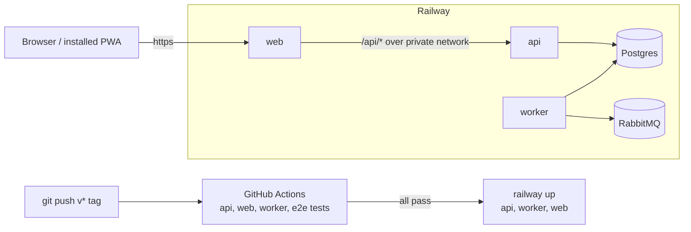

# Deployment

A dev version of the app runs on [Railway](https://railway.com): one service
each for the api, worker, and web, plus Railway's Postgres and a RabbitMQ
service. It's deployed by CI when a release tag is pushed, and the worker
sends email through [Resend](#email). There's no production deployment yet
(see [Not set up yet](#not-set-up-yet)).



## The Railway project as code

The project is described in [`.railway/railway.ts`](../.railway/railway.ts)
with Railway's
[Infrastructure as Code](https://docs.railway.com/infrastructure-as-code)
([reference](https://docs.railway.com/infrastructure-as-code/reference)):
every service's build, start, and pre-deploy commands, every variable, and
the Postgres and RabbitMQ services and their volumes. The release workflow
applies it before each deploy (see [Releases](#releases)), so change a
setting there, not in the dashboard: a dashboard change is overwritten by
the next release.

The file owns the whole environment. Applying it deletes any resource
missing from `resources` and any variable missing from a service's `env`,
so add new variables there (and to [Configuration](configuration.md)).
Destructive changes need `railway config apply --confirm-destructive`,
which the release workflow doesn't pass, so it fails instead; apply them by
hand after reviewing the plan.

To preview or apply a change locally, with the
[CLI](https://docs.railway.com/cli/config) (`npx @railway/cli`, logged in
with `railway login` and linked to the project with `railway link`):

```sh
npx @railway/cli config plan     # what would change; changes nothing
npx @railway/cli config apply    # asks before applying
npx @railway/cli config pull --variables=managed --force   # re-import after a dashboard change
```

`config pull` rewrites the file from the project, with the project name,
repo, and bucket as literals: put the environment variables below back
before committing.

The file names no project, repo, or bucket; it reads them from the
environment when it's evaluated, so they stay out of the repo:

| Variable               | What                                                                                                     |
| ---------------------- | -------------------------------------------------------------------------------------------------------- |
| `RAILWAY_PROJECT_NAME` | the Railway project's name; required                                                                     |
| `RAILWAY_GITHUB_REPO`  | the services' source repo, `owner/name`; defaults to `GITHUB_REPOSITORY` (set in GitHub Actions)         |
| `RAILWAY_GCS_BUCKET`   | the api's bucket (`tofu output media_bucket_name` in `infra/`); unset, the api gets no storage variables |

The release workflow passes them from the repository's Actions variables
(Settings → Secrets and variables → Actions → **Variables**: not secrets,
so they show in logs). Locally, export them before `config plan` or
`config apply`; the file stops with an error naming any that's missing.
Setting or clearing `RAILWAY_GCS_BUCKET` later adds or removes the api's
storage variables, and removing them is a destructive change.

The file imports the `railway` SDK (a root dev dependency). The CLI isn't a
dependency because its install script downloads a binary; the workflow pins
its version in `RAILWAY_CLI_VERSION`.

### Services

Railway calls this layout a
[shared monorepo](https://docs.railway.com/deployments/monorepo): every app
service builds from the repo root (it's a pnpm workspace, so each build
needs the whole repo) with its own commands:

| Service | Build                                   | Start                        |
| ------- | --------------------------------------- | ---------------------------- |
| api     | `pnpm exec turbo build --filter=api`    | `pnpm --filter api start`    |
| worker  | `pnpm exec turbo build --filter=worker` | `pnpm --filter worker start` |
| web     | `pnpm exec turbo build --filter=web`    | `pnpm --filter web start`    |

No service has a pre-deploy command: the api creates the schema when it
starts (see [Database schema](#database-schema)). A pre-deploy step for
reference data or migrations goes in the service's `preDeploy`.

Plus `Postgres`, and `RabbitMQ` with a `RabbitMQ Web UI` proxy for its
management UI, both from Railway's templates.

- **Watch paths are empty.** A `railway up` upload has no git diff, so with
  watch paths set Railway decides nothing changed and skips the build (see
  [Troubleshooting](#troubleshooting)).
- **Builds use `turbo build`,** not `pnpm --filter <app> build`, so the
  `@repo/*` packages the app imports at runtime are built too.
- **Automatic deploys are off** on each service (set in the dashboard,
  [disable automatic deployments](https://docs.railway.com/deployments/github-autodeploys#disable-automatic-deployments)):
  releases deploy from CI, and a push must not deploy untested code.
- **Only web has a public domain** (generated in the dashboard; generated
  domains aren't in the file,
  [public networking](https://docs.railway.com/networking/public-networking)).
  The browser never calls the api directly: web proxies `/api/*` to it over
  the [private network](https://docs.railway.com/networking/private-networking).

### Builds

Railway builds each app with
[Railpack](https://docs.railway.com/builds/railpack), which installs the
workspace with the pnpm version from the root `package.json`'s
`packageManager`; `RAILPACK_NODE_VERSION=24` pins Node
([Railpack's Node docs](https://railpack.com/languages/node)).

Railway builds have no `.git` directory, so the root `prepare` script (run by
`pnpm install`) is `lefthook install || exit 0`: installing the git hooks may
fail there without failing the build.

### Variables

Values owned by another service are
[references](https://docs.railway.com/variables#referencing-another-services-variable)
(`Postgres.env.PGHOST` in the file, `${{Postgres.PGHOST}}` in Railway), so
they follow that service when it changes. The secrets
(`BETTER_AUTH_SECRET`, the worker's `SMTP_URL` and `MAIL_FROM` (see
[Email](#email)), and RabbitMQ's) are `preserve()`: set once in the
dashboard, never in the repo.

- **`DB_*`** reference the Postgres service's `PG*` variables (api and
  worker).
- **`BETTER_AUTH_URL` and `WEB_URL`** are the web origin,
  `https://${{web.RAILWAY_PUBLIC_DOMAIN}}`, not the api's: the browser only
  talks to web, which proxies `/api/auth` (see [Authentication](auth.md)).
  With an `https://` URL Better Auth sets secure cookies, and `WEB_URL` makes
  the web origin trusted. Verification email links are built from
  `BETTER_AUTH_URL`, so they open on the web domain too.
- **`PORT=3002`** on the api. Railway injects `PORT` otherwise; the api
  (`app.listen(env.PORT)`, all interfaces) and `next start` (`0.0.0.0`)
  listen on it
  ([application failed to respond](https://docs.railway.com/networking/troubleshooting/application-failed-to-respond)).
- **`API_URL`** on web is `http://${{api.RAILWAY_PRIVATE_DOMAIN}}:3002`. It's
  read by the rewrites in `apps/web/next.config.ts`, which are fixed when web
  is built, so changing it needs a web redeploy.
- **Google sign-in:** `GOOGLE_CLIENT_ID` and `GOOGLE_CLIENT_SECRET` on the
  api and `GOOGLE_SIGN_IN` on web are `preserve()`, set in the dashboard.
  Set `GOOGLE_SIGN_IN=true` only once the api has the credentials, or the
  button leads to an error (see [Authentication](auth.md#sign-in-with-google)).
- **`RABBITMQ_URL`** on the worker and the api references RabbitMQ's
  `RABBITMQ_PRIVATE_URL` (the default vhost, `/`). The api publishes the
  verification email jobs; it declares only the exchange, so the worker must
  have started once to declare the `email` queue, or the jobs are dropped.
- **Storage:** when `RAILWAY_GCS_BUCKET` is set (see above), the api gets
  `STORAGE_DRIVER=gcs` and that bucket as `GCS_BUCKET`. The
  bucket and its service account are OpenTofu code in `infra/` (see
  [Infrastructure](infrastructure.md)); `GCS_CREDENTIALS`, the account's
  key, is set with `gcloud` and the Railway CLI
  ([The service account key](infrastructure.md#the-service-account-key)).
  Without `STORAGE_DRIVER` the api runs without storage (see
  [Storage](storage.md#in-the-api)).

Every variable is described in [Configuration](configuration.md).

## Email

The worker sends every email (so far the verification links) through
[Resend](https://resend.com)'s
[SMTP service](https://resend.com/docs/send-with-smtp), with the same
nodemailer mailer as Mailpit locally: no Resend SDK, only a different
`SMTP_URL`. The api sends no email itself: it publishes jobs for the
worker.

| Variable (worker) | Value                                                                 |
| ----------------- | --------------------------------------------------------------------- |
| `SMTP_URL`        | `smtps://resend:<api key>@smtp.resend.com:2465`, set in the dashboard |
| `MAIL_FROM`       | e.g. `My App <no-reply@<verified domain>>`, set in the dashboard      |
| `WEB_URL`         | the web origin, for the links in emails                               |

- **`smtps://` on port 2465** is TLS from the start. Railway blocks the
  standard SMTP ports (465 and 587 time out from the worker), so use
  Resend's alternative port 2465. The user is the literal
  `resend` and the password is an API key with **sending access** only. A
  key with characters that aren't allowed in a URL (`/`, `@`, `:`, `%`, …)
  must be URL-encoded (`node -p 'encodeURIComponent(process.argv[1])' '<key>'`);
  Resend's keys (`re_…`, letters, digits, and `_`) normally don't need it.
- **`MAIL_FROM`** must be an address on a domain verified in Resend, or
  Resend refuses every message (it's then parked, see below).
- **Both are required:** without `SMTP_URL` or `MAIL_FROM`, or with a value
  that isn't an `smtp(s)://` URL or an address, the worker stops at startup
  with an `Invalid environment variables` error and Railway restarts it
  until it gives up. Jobs wait in the queue meanwhile, so nothing is lost;
  setting the variables redeploys the worker. See
  [Decisions](decisions.md#email-settings-have-no-defaults).

Set them in the worker's **Variables** tab, or with the CLI (reading the
key from a prompt keeps it out of the shell history):

```sh
read -rs RESEND_KEY   # paste the API key, then Enter
printf 'smtps://resend:%s@smtp.resend.com:2465' "$RESEND_KEY" \
  | npx @railway/cli variable set SMTP_URL --stdin --service worker --skip-deploys
npx @railway/cli variable set 'MAIL_FROM=My App <no-reply@<verified domain>>' --service worker
```

The second command (without `--skip-deploys`) redeploys the worker with
both. Set them once `.railway/railway.ts` on `main` lists them: until then,
applying the file would delete them, a destructive change the release
workflow refuses.

### Checking delivery

- **Worker logs** (`railway logs --service worker`, or the service's
  **Deployments** tab): at startup `SMTP server smtp.resend.com:2465 accepted
  the connection.`, or `... check failed: <reason>` (a wrong key shows up
  here as `Invalid login: 535 ...`). Per message, `Sent <id> to user <id>.`
  or `Parking <message> (<reason>): <error>`.
- **[Resend's logs](https://resend.com/emails)** list every email it
  accepted, with its delivery status (delivered, bounced, complained).
- **Parked emails** are in RabbitMQ's `email.parked` queue, through the
  `RabbitMQ Web UI` service (see [Messaging](messaging.md#parked-messages)).

To check end to end, sign up on the web URL with your own address: the
verification email should arrive within seconds.

## Database schema

The api creates and updates tables only when `NODE_ENV` isn't `production`
(`apps/api/src/database.ts`), and there are no migrations yet (see
[Database](database.md)). So the api runs with `NODE_ENV=development` on
Railway, which syncs the schema on every start, as locally. The worker and
web run as production (Railpack's default). Migrations must replace this
before anything is deployed for real.

## Seeding

Nothing is seeded on Railway: create an account through the sign-up page.
**Never run the seeder (`script/seed`, `apps/api/src/seed.ts`) against
Railway**: it creates the fixture users, whose password is in the repo, so
anyone could sign in as them. The seeder only refuses
`NODE_ENV=production`, which the api on Railway isn't (see
[Database schema](#database-schema)). Reference data every environment
needs would get its own seed command, run as the api's pre-deploy.

## Releases

Pushing a tag that starts with `v` runs
[`.github/workflows/release.yml`](../.github/workflows/release.yml):

```sh
git switch main && git pull
git tag -a v0.2.0-rc.1 -m "v0.2.0-rc.1" && git push origin v0.2.0-rc.1
```

### Choosing the version

Versions are `vMAJOR.MINOR.PATCH` ([semantic versioning](https://semver.org)).
Pick the next one from the commits since the last release, which are
Conventional Commits, so it's mechanical:

```sh
git log --oneline <last tag>..origin/main
```

- **Any `feat` commit** (a story's feature): bump MINOR and reset PATCH,
  e.g. `v0.2.0` → `v0.3.0`.
- **Only `fix` commits** (no `feat`): bump PATCH, e.g. `v0.2.0` → `v0.2.1`.
- **Only `docs`, `test`, `refactor`, `build`, or `chore`:** nothing users
  see changed, so there's no need to release. Ship it with the next one, or
  as a PATCH if it has to deploy (a CI or Railway config fix).
- **MAJOR stays 0** until the app is ready for real users; then cut
  `v1.0.0`. After that, MAJOR is for changes that break something users
  rely on.

**Every version ships as release candidates first** (`vX.Y.Z-rc.N`, a
GitHub prerelease):

1. Tag `vX.Y.Z-rc.1` and check the deployment on Railway.
2. If it needs fixes, release them as `-rc.2`, `-rc.3`, … of the same
   version. If a new feature lands before the version is final, it becomes
   the next MINOR's `-rc.1` instead, and the unfinished version is skipped
   (e.g. `v0.1.0-rc.3` deployed, but `v0.2.0-rc.1` added a feature, so
   there's no `v0.1.0`).
3. When an rc is good, promote it: tag the same commit as the plain version
   and make it a full (not pre-) release.

   ```sh
   git tag -a v0.2.0 -m "v0.2.0" v0.2.0-rc.1^{} && git push origin v0.2.0
   ```

   Its tests are skipped (nothing changed since the rc passed), and it
   redeploys the same code.

Each tag gets a GitHub release with a changelog grouped by feature and
story. An rc's changelog covers everything since the last final release (or
the start, before the first one), with what changed since the previous rc at
the top, so the latest rc's notes are complete on their own.

The workflow's jobs:

1. **changes** picks which suites to run (see
   [Skipping unaffected suites](#skipping-unaffected-suites)).
2. **test**, one parallel job per picked app: `script/test -a=api`, `-a=web`,
   `-a=worker`, or `-a=e2e`, the same as locally (see [Testing](testing.md)),
   against the docker compose services on the runner. The `.env` files are
   the `.example` ones with random secrets. A failed e2e job uploads the
   Playwright report and traces as the `playwright-report` artifact.
3. **config**, only if every test job passed (or none had to run): `railway config apply --yes`
   brings the project in line with `.railway/railway.ts`. It fails on
   destructive changes (see [above](#the-railway-project-as-code)).
4. **deploy**, once the config is applied:
   [`railway up --ci --service <name>`](https://docs.railway.com/cli/up) for
   the api, worker, and web, in parallel. It uploads the tagged checkout
   (respecting `.gitignore`), builds it on Railway with the service's
   settings, and fails if the build does. Each deploy job times out after
   20 minutes. The three are always deployed
   together (see [Decisions](decisions.md)).

### Skipping unaffected suites

A release only runs the suites of apps that changed since the **last
release whose workflow passed** (found with `gh run list`; comparing against
the previous tag instead would skip suites a failed release never passed).
`.github/scripts/affected-apps <base>` decides, and prints the apps as a JSON array;
run it locally to see what a release would test, e.g.
`.github/scripts/affected-apps v0.1.0-rc.2`.

- **Imports come from the package graph.** An app is affected when its own
  files change or any workspace package it depends on does (Turbo's
  `turbo ls --affected`): a change to `@repo/entities` tests the api and
  worker, one to `@repo/contracts` the api and web. pnpm's strict
  `node_modules` makes an undeclared `@repo/*` import fail, so the graph
  matches the imports.
- **Root files every package uses** are Turbo `globalDependencies` and mark
  everything affected: `tsconfig.base.json`, `docker-compose.yml`, the root
  `package.json` and `pnpm-workspace.yaml`, the `.env` files and their
  `.example`s (CI's `.env` is made from them), and `turbo.json` itself.
  Turbo attributes lockfile changes to the packages whose dependencies
  changed. A new root file the tests read belongs in that list.
- **e2e runs whenever api, web, or worker is affected**, since it runs their
  builds by path, which the graph can't see.
- **Changes to `.github/` or `script/`** (how the suites run) run every
  suite, and so does a release with no passing release before it.
- Docs-only changes run no suite: the release still applies the config and
  deploys.

The CLI authenticates with the `RAILWAY_TOKEN` repository secret
(**Settings → Secrets and variables → Actions** on GitHub): a
[project token](https://docs.railway.com/integrations/api#project-token),
created on the **Tokens** page of the Railway project's settings. A project
token is scoped to one environment, which is where the workflow applies the
config and deploys. The service names in the workflow must match the ones in
`.railway/railway.ts`.

The workflow only runs tests: lint, format, and type errors are caught by the
[git hooks](development.md#git-hooks).

To follow a deploy, open the service's **Deployments** tab, or run
`railway logs --service <name>` after `railway link`.

## First deploy checklist

1. The repository variables `RAILWAY_PROJECT_NAME` (and
   `RAILWAY_GCS_BUCKET` if the api should have storage) are set on GitHub
   (see [The Railway project as code](#the-railway-project-as-code)).
2. The services in `.railway/railway.ts` exist in the project, with
   automatic deployments disabled on api, worker, and web.
3. The secrets are set in the dashboard: `BETTER_AUTH_SECRET` on the api
   (`openssl rand -base64 32`), and
   `SMTP_URL` and `MAIL_FROM` on the worker (see [Email](#email)).
4. web has a public domain.
5. `RAILWAY_TOKEN` is set on GitHub.
6. `npx @railway/cli config plan` shows no destructive changes.
7. Push a `v*` tag and watch the workflow in the repo's **Actions** tab.
8. Open the web URL, sign up, and open the emailed link: that covers web → api over the
   private network, auth cookies, the database, and the queue. The worker's logs should
   show `Connected to RabbitMQ` and the SMTP check (see
   [Email](#email); `SMTP_URL` and `MAIL_FROM` must be set first).

## Installing the app on a phone

The web app is an installable PWA (see [Web app](web.md#pwa)). Browsers only
offer to install it over HTTPS, which the `*.up.railway.app` domain has.
Open the web URL on the phone:

- **Android (Chrome):** accept the **Install app** prompt, or ⋮ menu →
  **Install app** (or **Add to Home screen**).
- **iPhone (Safari):** Share → **Add to Home Screen** → **Add**. On iOS 16.4
  and later, other browsers have the same item in their share menu.

It opens full screen at `/`, which goes to `/dashboard` or `/login`. On iOS the
installed app doesn't share cookies with Safari, so sign in again inside it.
After a release, pages come from the new build on the next load; the new
service worker takes over the next time the app is fully closed and reopened.

## Troubleshooting

- **`pnpm install` fails at `prepare` with a lefthook error:** the build has
  no `.git`; `prepare` must stay `lefthook install || exit 0`.
- **`nest: not found` or `tsc: not found` during the build:** the install
  skipped devDependencies (the Nest CLI and TypeScript are dev
  dependencies). Check the build log for `NODE_ENV=production` during
  install, and make sure no variable such as `RAILPACK_PRUNE_DEPS` removes
  them before the build
  ([Railpack's Node docs](https://railpack.com/languages/node)).
- **Application failed to respond:** the app isn't listening on `PORT`, or
  the domain targets another port
  ([troubleshooting](https://docs.railway.com/networking/troubleshooting/application-failed-to-respond)).
- **Sign-in fails with an origin error, or the cookie isn't kept:**
  `WEB_URL` or `BETTER_AUTH_URL` doesn't match the web domain exactly
  (`https://`, no trailing slash).
- **Requests to `/api/*` fail with 500s from web:** `API_URL` is wrong, or
  was changed without redeploying web.
- **A deploy job hangs, and its log ends with "no changes detected in watch
  paths, build will skip":** the service has watch paths. `.railway/railway.ts`
  sets them empty and the `config` job applies that, so someone set them in
  the dashboard after; apply the config (or rerun the release). The job gives
  up after 20 minutes.
- **The `config` job fails on a destructive change:** the file would delete a
  resource or variable. Run `npx @railway/cli config plan`, and either add
  what's missing to the file or apply the deletion by hand
  (`config apply --confirm-destructive`).
- **The worker restarts over and over with `Invalid environment variables`
  naming `SMTP_URL` or `MAIL_FROM`:** they aren't set, or aren't valid, on
  the worker service (see [Email](#email)).
- **Errors about missing tables:** the api isn't running with
  `NODE_ENV=development`, or hasn't started since an entity changed.

## Not set up yet

- **Migrations,** so the api can run as production.
- **Pre-built images:** building Docker images in CI and deploying those,
  so Railway runs exactly the build CI tested.

## Railway docs

- [Deploying a monorepo](https://docs.railway.com/deployments/monorepo)
- [Variables](https://docs.railway.com/variables) and the
  [variables reference](https://docs.railway.com/variables/reference)
- [Private networking](https://docs.railway.com/networking/private-networking)
  and [public networking](https://docs.railway.com/networking/public-networking)
- [PostgreSQL](https://docs.railway.com/databases/postgresql)
- [Railpack](https://docs.railway.com/builds/railpack) and
  [build configuration](https://docs.railway.com/builds/build-configuration)
- [GitHub autodeploys](https://docs.railway.com/deployments/github-autodeploys)
- [CLI: `railway up`](https://docs.railway.com/cli/up) and the
  [CLI reference](https://docs.railway.com/reference/cli-api)
- [Project tokens](https://docs.railway.com/integrations/api#project-token)
- [Infrastructure as Code](https://docs.railway.com/infrastructure-as-code),
  its [reference](https://docs.railway.com/infrastructure-as-code/reference),
  and [`railway config`](https://docs.railway.com/cli/config)
- [Pre-deploy command](https://docs.railway.com/deployments/pre-deploy-command)
